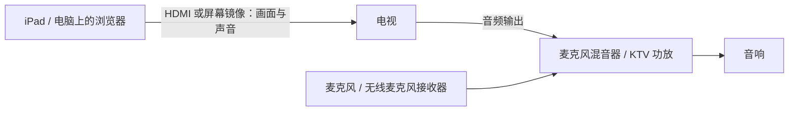

# 退学 KTV

本仓库是 [Trinkle23897/karaoke](https://github.com/Trinkle23897/karaoke) 的 Windows 适配分支。保留原项目的点歌、分离、歌词对齐、字幕与播放设计，补充 Windows 原生运行支持，默认采用本地 ASR，并支持通过已登录 ChatGPT 的 Codex CLI 或本地文本模型整理元数据。原作者版权及 [MIT License](LICENSE) 保持不变；下面继续保留原项目功能、使用方式和历史实测说明。

把 YouTube 视频，实时变成可以唱的卡拉 OK：网页点歌、后台预处理、共享歌单和自动播放下一首。

新歌在点歌后自动开始准备，完成音轨分离、字幕和 MV 生成后即可开唱；处理耗时见下方[实测参考](#处理一首歌要多久)。

也可以把它当成你自己的 KTV 起点：接喜欢的内容来源、改界面、加玩法，自己手搓，或让 Claude Code / Codex 和你一起改。

[快速开始](#快速开始) · [界面预览](#界面预览) · [实际部署](#实际部署把客厅变成-ktv) · [自己动手改](#自己动手改)

## 界面预览

看看实际的点歌、搜索和字幕播放效果。示例歌曲及素材出处见[截图说明](docs/images/README.md)。

### 全屏播放与字幕

琥珀色逐字／词点亮，下一句提前显示。粤语歌词带粤语拼音，日文歌词的汉字带平假名注音，读音显示在对应文字上方；底部保留播放进度、主唱音量和升降调。


### 桌面点歌台

按歌手浏览、从曲库点歌，右侧安排待唱顺序。


### 综合搜索

搜索歌名，分别展示曲库里的歌与在线结果，保留不同歌手和版本。


### 歌手搜索

搜索歌手后直接展开作品列表，可切换其他候选并逐首点歌。


### 正在播放

普通播放页同时显示字幕画面、待唱列表和播放控制。


### 手机待唱 · 夜间模式

待唱顺序和播放控制同屏显示。


## 当前功能

- 按歌名查 YouTube Music 歌曲，或找歌手浏览热门歌曲；下拉自动加载更多，支持播放量排序、预览和直接点歌，也保留原始 YouTube 视频搜索和视频链接。电脑和手机均显示歌词检查状态，支持「有歌词优先」排序。后台准备与播放顺序分别维护。
- 自动下载视频，分离背景音乐、伴唱、主唱，生成带字幕的 MV。
- 多语言歌词对齐（中日英保留专用唱歌模型细化）；当前句＋下一句，琥珀色逐字／词点亮，硬切换句，片头歌曲信息和四秒开唱提示。
- 粤语拼音与日文平假名：粤语歌词显示粤拼，日文歌词的汉字显示平假名注音，在生成字幕时完成。
- 暂停、定位、重唱、下一首、全屏；混音后实时升降调，主唱音量按百分比调节。
- 伴奏和伴唱始终开启，主唱 0–100% 加减按钮支持全屏调整，每次 5 个百分点；各设备独立播放；默认 10 GiB 歌曲缓存上限与 LRU 自动回收。
- SQLite 持久化，SSE 推送进度；同一局域网可以用手机点歌和播放。

项目采用共享歌单、各设备独立播放的单房间模式，自动获取已发表歌词，使用 AI 分离原曲音轨并把歌词对齐到当前录音。准备失败时会保留已完成的步骤，排除问题后可继续处理，详见[状态与恢复](karaoke/APP.md#状态与恢复)。

## 快速开始

### 让编程助手帮你安装

如果你已经在用 Claude Code（CC）、Codex 或其他编程助手，可以直接把下面这段发给它：

```text
请帮我在本机安装并运行 https://github.com/rcy17/karaoke-windows 。
按 AGENTS.md 和 SETUP.md 检查硬件，为本机安装独立环境、依赖和模型。
优先配置本地模型和使用 ChatGPT 登录的 Codex CLI；不要自动启用付费 API。
需要来源平台登录或模型资源时，指导我完成本机配置。
安装后通过正常点歌流程处理一首完整歌曲，例如周杰伦《稻香》。
等原任务 completed、待唱项可播放，核对音轨、字幕、完整视频和文件哈希，
再用静音浏览器预览检查加载、定位、字幕和主唱开关；遇到问题继续排查。
以首歌可唱为完成标准，给我网页地址、歌曲名称、验证结果和以后启动／停止的方法。
需要我提供登录信息或补充资源时，告诉我具体怎么做。
```

首次安装需要下载依赖和模型，耗时取决于硬件和网络。只想先看看界面，也可以从下面的最小环境开始。

### 先启动网页

下面是 macOS / Linux 的最小启动方式，需要 Python 3.12；已有仓库时直接进入仓库目录：

```sh
git clone https://github.com/rcy17/karaoke-windows.git
cd karaoke-windows
python3.12 -m venv .venv
.venv/bin/python -m pip install -r karaoke/requirements-api.txt
.venv/bin/python -m karaoke.api
```

Windows 10/11 x64 使用 PowerShell（Python 3.12）：

```powershell
git clone https://github.com/rcy17/karaoke-windows.git
cd karaoke-windows
py -3.12 -m venv .venv
.\.venv\Scripts\python.exe -X utf8 -m pip install -r karaoke/requirements-api.txt
.\.venv\Scripts\python.exe -X utf8 -m karaoke.api
```

Windows 全部处理依赖、独立分离环境、字体和检查命令见 [Windows 安装步骤](SETUP.md#windows-powershell)。`-X utf8` 用于读写中文歌词和 JSON；子任务同样使用 UTF-8。

打开 <http://127.0.0.1:8746/>，接口文档在 <http://127.0.0.1:8746/docs>。前端不需要构建。

仓库不包含歌曲数据，初次启动曲库为空。上面的步骤可以启动界面和队列；真正处理新歌还需要 [安装说明](SETUP.md) 中的 FFmpeg、Node.js、推理依赖和模型权重。默认本地识别＋Codex CLI 文本整理不需要 `OPENAI_API_KEY`；也可选择纯本地文本服务或禁用文本模型。Codex 需用 ChatGPT 账号登录，消耗账号订阅额度，受相应限额约束；不代表无限调用。付费 API 仅在显式选择 `api` 后使用，失败不会自动切换到 API。配置和限制见 [运行配置](SETUP.md#5-运行配置)。

完整环境准备好后，按[首歌步骤](SETUP.md#6-准备第一首歌)处理一首歌，例如《稻香》。电脑和手机都可以用「有歌词优先」挑选版本。歌曲完成后会出现在曲库，打开播放页即可开唱。更多操作见[使用说明](karaoke/APP.md)；在启动服务的终端按 `Ctrl+C` 可以停止服务。

### 内存与使用规模

推荐配置（每次准备一首歌）：

| 处理主机 | 推荐内存 | 推荐显存 |
| --- | --- | --- |
| Apple Silicon Mac | 24 GB 统一内存 | 与内存共享 |
| NVIDIA GPU 主机 | 32 GB | 16 GB |

只用浏览器点歌、播放的设备不需要上述配置。安装与并发设置见 [SETUP](SETUP.md#安装前检查内存)。

面向万人在线浏览、部分设备播放的部署，按服务端连接数、状态推送和媒体出站带宽规划容量，并在目标硬件与网络上压测。歌词检查已采用可见歌曲按需查询、批量请求、同录音请求合并和并发上限；更多设计见[大量在线访问与长歌单](karaoke/docs/design/app.md#大量在线访问与长歌单)。

### 处理一首歌要多久？

下面是已完成整曲音轨、字幕和 MV 的实测样例，模型均已安装：

| 硬件 | 歌曲时长 | 处理耗时 | 计时范围 |
| --- | --- | --- | --- |
| Apple M4 Max · 128 GiB · MPS | 《富士山下》，4 分 19 秒 | 约 3 分钟（178.35 秒） | 复用原视频、歌词和解码缓存，重新分离音轨、对齐字幕并生成完整 MV |
| RTX 5090 32 GB · Ryzen 9 9900X · 128 GB 内存 | Unravel，3 分 58 秒 | 约 1 分 21 秒（81.01 秒） | 从提交请求到可唱，包含重新下载、联网取歌词、分离、对齐和完整 MV 生成 |

表中是不同版本与缓存条件下的单次记录，计时范围见最后一列。另一组 M4 Max 五首记录平均约 5.9 分钟，最长约 8.1 分钟；实际等待时间受歌曲长度、对齐难度、网络和并发任务影响。已准备好的歌曲直接复用成品缓存。完整测量条件见[性能记录](karaoke/docs/lead-backing-performance.md#2026-10-14readme-耗时参考)。

## 实际部署：把客厅变成 KTV

除了运行项目的电脑／服务器，可以复用家里的电视和 iPad、手机或电脑，再配麦克风和能把伴奏、人声同时混音的音响设备。电视显示画面，网页播放伴奏，麦克风负责把你的歌声送进音响。



带伴奏输入和麦克风混音功能的一体 KTV 音响，可合并图里的混音器与音响。普通音响或回音壁若没有麦克风混音功能，可外接混音设备，按电视提供的 HDMI ARC、光纤或 AUX 音频输出匹配接口。单独的混音器接有源音响，或经功放连接无源音箱。接线可参考[电视音频回传说明](https://helpguide.sony.net/tv/lusltn1/v1/en-003/04-04_01.html)和[电视伴奏与麦克风混音示例](https://www.soundtown.com/products/swm15-pro)。

1. 在 iPad、手机或电脑上打开项目网页，点歌并进入全屏播放。播放设备与运行服务的电脑可以分开；局域网访问配置见 [SETUP](SETUP.md#5-运行配置)。手机／平板使用实时升降调需要受信任的 HTTPS 入口。
2. 用 HDMI 输出，或把整个屏幕镜像到电视，并确认网页声音也从电视输出。本项目的音轨与视频分开播放，仅投送视频文件可能没有伴奏。iPad 可参考 Apple 的[屏幕镜像](https://support.apple.com/zh-cn/102661)与[有线转接器说明](https://support.apple.com/zh-cn/108399)。
3. 将电视的声音送入混音设备的伴奏输入，麦克风或其无线接收器接入对应的麦克风输入，再由音响同时播放伴奏和你的歌声。
4. 用音响／混音器调节自己的麦克风音量；网页里的「主唱」音量调节的是歌曲原唱，实时升降调也只处理歌曲音轨。当前网页不接收或处理你的麦克风声音。

麦克风直接接混音设备再到音响，无线麦克风使用配套接收器，可以减少人声延迟。开唱前试一句话，再对照电视上的字幕与伴奏；投屏不稳定或不同步时，先试有线 HDMI 和有线音频连接。

## 自己动手改

源码在这里，欢迎把它改成适合自己的 KTV。当前自带的音视频点歌来源是 YouTube / YouTube Music；你可以继续手搓新的入口和玩法，比如：

- 给 B 站、网易云等平台增加点歌入口，或加入本地音视频导入。
- 导入自己的歌单，加收藏、练歌记录，按自己的习惯整理曲库。
- 做适合家里电视的大屏界面，或把手机做成专用遥控器。
- 换主题、字体和字幕样式，增加其他语言的注音，尝试不同的分离或对齐模型。

这些只是改造思路，欢迎按自己的需求继续发挥。也可以直接让编程助手帮忙，例如：

> 请帮这个项目加一个本地音视频导入入口，复用现有的分离、字幕和播放流程，完成后验证原有点歌和播放仍然正常。

做出来觉得别人也会用，欢迎提 PR；只有想法也欢迎开 Issue 交流。开发入口和验证方法见[贡献指南](CONTRIBUTING.md)。

## 文档与指令

- [贡献指南](CONTRIBUTING.md)：开发、测试和安全提交。
- [开发指令](AGENTS.md)：给 Codex 和后续开发者的项目约束。
- [安装与模型准备](SETUP.md)：环境、固定版本的上游源码、权重位置、验证命令。
- [网页使用说明](karaoke/APP.md)：点歌、播放、主唱音量和多设备播放。
- [API](karaoke/API.md)：请求、任务状态、成品下载和环境变量。
- [界面设计](karaoke/docs/design/app.md) · [字幕设计](karaoke/docs/design/subtitles.md)。
- [切字验收](karaoke/docs/word-onset-metrics.md) · [主唱／伴唱验收](karaoke/docs/lead-backing-metrics.md) · [整体验收](karaoke/ACCEPTANCE.md)。
- [自动质量检查](karaoke/docs/automatic-quality.md)：独立参考评分、疑点检查器的漏报／误报和故障注入验证。

## 代码结构

```text
karaoke/
  api.py, room.py, job_schema.py    HTTP、任务队列、共享歌单和准备状态
  pipeline.py, song_sources.py     下载、分离、歌词、对齐、导出
  web/                            原生 HTML / CSS / JavaScript 播放器
  exact_stems.py, three_stems.py   可重组的双轨、三轨母版
  align_*.py, phoneme_progress.py  词／音素对齐与保护规则
  subtitle*.py, render_*.py        字幕布局、点亮、视频导出
  benchmark_neural.py             正式流程使用的分离子进程入口
  benchmark_*.py, dsp.py           其余算法实验与评测工具
  experiments/cjk-onsets-v003/    当前流程仍使用的多窗口对齐代码
  dependencies/                  权重来源与校验值（不含权重）
  models/pretrained/*.yaml        分离模型配置（不含权重）
```

详细入口见[源码导航](karaoke/README.md)。仓库保存代码、配置、文档与上述界面截图；运行所需的歌曲、歌词库、音轨、MV、任务数据库、实验产物、模型权重、大型第三方研究仓库和虚拟环境由使用者另行准备。

## 许可

项目自行编写的代码与文档采用 [MIT License](LICENSE)。第三方组件、模型与截图素材保留各自许可，详见[第三方说明](THIRD_PARTY.md)和[截图来源](docs/images/README.md)。下载、处理和分享音乐内容时，请遵守相应内容授权与来源平台条款。

## 验证

[GitHub Actions](https://github.com/rcy17/karaoke-windows/actions/workflows/checks.yml) 在 push、PR 和手动触发时运行 Windows 与 Linux 静态检查，包括 Ruff、ty 和 ESLint。开发工具安装与检查命令见[贡献指南](CONTRIBUTING.md#修改与验证)。

本项目已移除单元／行为测试，禁止新增或恢复测试代码。保留静态检查、实际操作和正式产物校验；静态检查通过不能证明模型质量或整曲可唱，首次安装仍须完成 [SETUP 的首歌验收](SETUP.md#6-准备第一首歌)。
